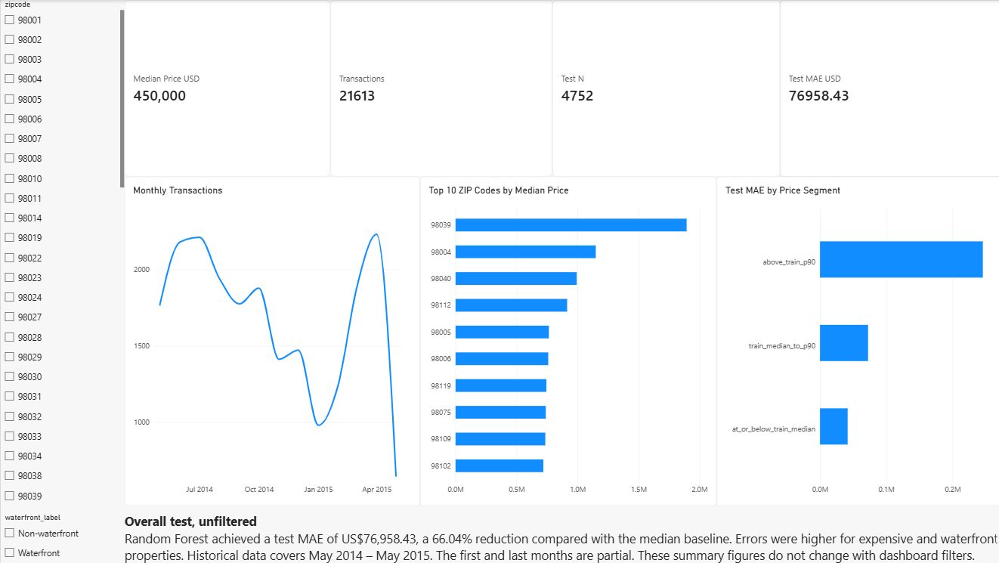

# Property Sales Analytics & House Price Modeling

An end-to-end analysis of **21,613 residential property transactions in King County, USA (2014–2015)**. The project combines a Python data audit, PostgreSQL validation and business analysis, chronological price modeling, and an interactive Power BI report.

The analysis answers two questions: **how do recorded sales vary across time and property characteristics, and how well can a model estimate prices for later transactions?**



## Results

The dataset contains **21,436 distinct properties**, with a median transaction price of **$450,000**. Random Forest achieved the lowest validation MAE among a median baseline, Ridge regression, and Random Forest. After selection, the model was refitted on training and validation data and evaluated on 4,752 later transactions.

| Test model | MAE (USD) | RMSE (USD) | R² | Median absolute error (USD) |
|---|---:|---:|---:|---:|
| Random Forest | 76,958.43 | 139,854.34 | 0.8578 | 44,465.90 |
| Median baseline | 226,622.19 | 385,509.10 | -0.0807 | 149,075.00 |

The selected model reduced test MAE by **66.04%** relative to the refitted median baseline. This measures error reduction, not classification accuracy. Errors were substantially larger for expensive and waterfront properties.

Three descriptive findings from the SQL analysis:

- ZIP code **98039** had the highest median sale price: **$1,895,000**, based on 50 transactions.
- **April 2015** had the highest recorded monthly transaction count: **2,231**. The first and last months have partial coverage.
- Waterfront properties had a median sale price of **$1,400,000** across 163 transactions, compared with **$450,000** for non-waterfront properties.

Read the complete interpretation in [notebook 3, Section 14](notebooks/3_modeling.ipynb), the [business findings](docs/business_insights.md), and the [model card](docs/model_card.md).

## Project contents

| Location | Purpose |
|---|---|
| [1_data_audit.ipynb](notebooks/1_data_audit.ipynb) | Data quality checks, cleaning decisions, and reference exports |
| [2_postgresql_property.ipynb](notebooks/2_postgresql_property.ipynb) | Import verification, SQL/Python parity checks, and business KPIs |
| [3_modeling.ipynb](notebooks/3_modeling.ipynb) | Time split, model comparison, evaluation, saved pipeline, and results interpretation |
| [sql/](sql/) | Schema, quality checks, clean views, and KPI queries |
| [src/](src/) | Database access, repeat-safe ingestion, artifact checks, and dashboard export |
| [data/](data/) | Original CSV and deterministic audit references |
| [reports/sql_validation/](reports/sql_validation/) | Saved SQL checks, KPI tables, and charts |
| [reports/modeling/](reports/modeling/) | Metrics, predictions, split assignments, diagnostics, and provenance |
| [models/](models/) | Fitted pipeline and model metadata |
| [dashboard/](dashboard/) | Power BI report, input CSV, export manifest, and screenshot |

The raw CSV is audited in Python and imported into PostgreSQL. The `raw`, `staging`, and `analytics` schemas separate source records, typed/cleaned views, and business aggregates. The modeling notebook verifies the clean database data before fitting local Python pipelines. Power BI uses a CSV snapshot joined to the saved test predictions.

## View the completed analysis

The repository includes notebook outputs, reports, data, the fitted model, and the Power BI file. Training is not required to inspect these results.

1. Open the three notebooks in order, or read their saved outputs on GitHub.
2. Open [property_analytics.pbix](dashboard/property_analytics.pbix) in Power BI Desktop. Its saved data snapshot is included.
3. To check the saved modeling artifacts without connecting to PostgreSQL or retraining, run this command from the repository root:

   ```bash
   python -m src.check_modeling_artifacts
   ```

   Expected result: `CHECK_PASSED`. The checker compares notebook code, recorded inputs, SQL files, and all 22 recorded modeling outputs with their saved hashes.

## Reproduce the workflow

### Environment and database

The recorded run used Python **3.10.9**. Core package versions are pinned in [requirements.txt](requirements.txt); the file is not a full transitive lockfile. Use the recorded environment when loading the saved scikit-learn model.

From the repository root, create and activate an environment, then install dependencies. For Windows PowerShell:

```powershell
python -m venv .venv
.\.venv\Scripts\Activate.ps1
python -m pip install -r requirements.txt
Copy-Item .env.example .env
```

Set the PostgreSQL credentials in `.env`, create the database `property_analytics_database`, and connect DBeaver to that database. Select the installed Python environment as the VS Code notebook kernel. All required project folders are included.

### Notebook and SQL execution order

Run notebook 1 first. It produces deterministic audit references without estimating imputation parameters. Then follow the checkpoints in notebook 2:

| Order | Run in DBeaver | Run in notebook 2 |
|---|---|---|
| 1 | Connect to `property_analytics_database` | Sections 1–3: paths, references, and connection |
| 2 | Entire `sql/0_schema.sql` | Sections 4–5: schema checks, import, and raw cell comparison |
| 3 | `sql/1_quality_checks.sql`: raw checks first, then the typed-view block and remaining checks | Sections 6–8: raw quality, duplicates, and domain checks |
| 4 | `sql/2_clean_view.sql`, then `sql/4_validate_clean.sql` | Sections 9–10: clean summary and all 21,613 × 28 values |
| 5 | Entire `sql/3_business_kpis.sql`, including its four `CREATE` blocks | Sections 11.a–11.e, 12, and 13: KPIs, aggregate validation, and saved report |

The `sql/` folder stores the queries; saving a file does not execute it. Commit successful DDL in DBeaver if manual transaction mode is enabled so the notebook connection can see the changes. Preserve the `-- @statement` markers used by the notebook to locate queries.

Section 5 imports the CSV through `src.ingest`. Do not add a second manual import. Repeated `CREATE OR REPLACE VIEW` statements update view definitions without inserting duplicate raw transactions. An existing database with the same verified objects can be checked by running notebook 2 in order.

Next, save notebook 3, restart its kernel, run all cells, and save the completed notebook. It reads PostgreSQL in a read-only transaction; model fitting happens in Python. The chronological split is:

| Split | Date rule | Transactions |
|---|---|---:|
| Training | Before 2015-01-01 | 14,633 |
| Validation | 2015-01-01 through 2015-02-28 | 2,228 |
| Test | From 2015-03-01 | 4,752 |

Model selection uses validation MAE. Preprocessing is fitted within each pipeline. The selected configuration is then fitted on 16,861 training and validation rows before test evaluation. Property IDs may appear in more than one period; the task evaluates later transactions.

After reproducing modeling, verify and export the results:

```bash
python -m src.check_modeling_artifacts
python -m src.export_dashboard
```

### Power BI

Open the included PBIX. If the project folder has moved, use **Transform data → Data source settings → Change Source** to select `dashboard/data/property_sales_dashboard.csv`, then refresh. Keep the query/table name `Sales`. The report reads this CSV, so a PostgreSQL connection is not needed to view or refresh it.

With filters cleared, the four cards should show **21,613 transactions**, **$450,000 median price**, **4,752 test rows**, and **$76,958.43 test MAE**. The report also contains monthly transactions, the top 10 ZIP codes by median price, test MAE by price segment, and ZIP/waterfront slicers. Prediction fields are blank outside the test split. The static note labelled **“Overall test, unfiltered”** does not change with slicers.

The included CSV already corresponds to the saved model run. Export it again only when the underlying results change, then refresh Power BI.

## Data source and provenance

Source: [House Sales in King County, USA, published by Harlfoxem on Kaggle](https://www.kaggle.com/datasets/harlfoxem/housesalesprediction). The source listing identifies the dataset license as **CC0: Public Domain**. Dataset coverage is 2 May 2014 through 27 May 2015.

The supplied raw file is `data/raw/kc_house_data.csv`. Its SHA-256 is:

```text
02d5580da2ef7f0dd69effdf68f59a5a6788fe4f55533dab3e9e035d4bd4586e
```

Audit manifests, SQL validation evidence, and the modeling report record the inputs and outputs for the saved run. Investigate unexpected hash differences before rerunning or replacing artifacts. `.gitattributes` preserves the exact bytes of hash-checked data, SQL, and reports across Git checkouts. Credentials and local environments are excluded by `.gitignore`.

## Limitations

- These are historical transactions from one US county; performance does not establish current-market accuracy or transfer to another location.
- Exploratory analysis used the full file before the modeling experiment. The chronological test period was excluded from fitting and model selection, but was not entirely unseen during exploration.
- Property IDs overlap across time splits, and historical availability of every feature at prediction time is unverified.
- High-price and waterfront transactions have much larger dollar errors. Waterfront test results contain only 35 observations.
- Sales counts describe recorded activity, and price comparisons and permutation importance are associations rather than causal estimates.
- The project compares fixed model configurations. It provides no prediction intervals or production appraisal validation.
